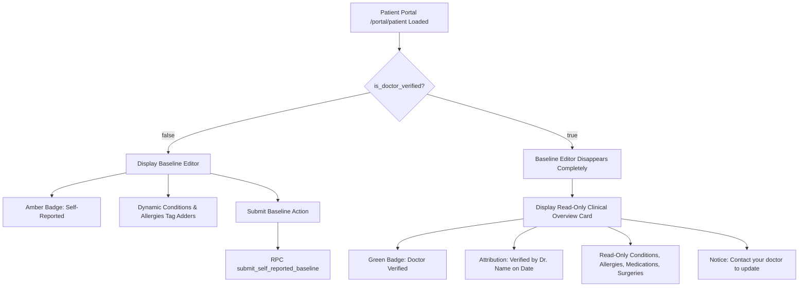

# Milestone M5 Security Boundaries, RLS Constraints & Disappearing Edit UI Architecture

**Author**: Explorer M5-3 (teamwork_explorer)  
**Date**: 2026-11-01  
**Scope**: Milestone M5 (Patient Portal: Demographics, Privacy Invariants & Disappearing Clinical Baseline)  
**Status**: Completed Investigation & Architecture Specification  

---

## Executive Summary

Milestone M5 establishes the Patient Portal (`/portal/patient`), where patients manage demographic details, emergency contacts, dependents, and their initial health baseline. Medical data handling in Umbrella is strictly safety-critical:
1. **Disappearing Edit UI (DECISIONS D3 & D7)**: The patient baseline editor is strictly available **only** while `clinical_records.is_doctor_verified = false`. Once verified by an approved clinician, the edit UI disappears completely from the DOM and is replaced by a read-only verified clinical summary with clinician attribution ("Verified by Dr. \<name\> on \<date\>. Contact your doctor to update").
2. **Privacy Isolation (Non-Negotiable N1)**: Sensitive fields (`residential_address`, `spouse_dependents`, `email`) are restricted to the authenticated patient and approved clinicians via Row Level Security (RLS). They are strictly excluded from the unauthenticated public emergency RPC `get_emergency_triage_by_token`, public routes, and client-side bundles.
3. **Clinician Name Attribution**: When displaying doctor verification metadata, the portal queries the verifying doctor via `clinical_records.last_updated_by_doctor_id`. RLS on `accounts` allows access when an appointment exists. We provide resilient fallback logic ("Verified by Attending Clinician") to handle edge cases without appointments and document the recommended RLS policy expansion.
4. **Input Constraints & Edge Cases**: The RPC `submit_self_reported_baseline(p_conditions, p_allergies)` strictly accepts conditions and allergies (max 50 entries each per D7). We specify concurrent edit race-condition handling, empty-state initialization for freshly registered patients, and friendly user error handling conforming to Rule 02 #7.

---

## 1. Disappearing Edit UI Architecture (DECISIONS D3 & D7)

### 1.1 Database Invariant & Trigger Mechanics
The clinical record lifecycle is governed by Postgres triggers and security-definer RPC functions in `supabase/migrations/0001_umbrella_schema.sql`:
- **Initial State**: When a patient registers, the trigger `trg_patient_profile_clinical` invokes `create_clinical_record()`, initializing `public.clinical_records` with:
  - `is_doctor_verified = false`
  - `last_updated_by_doctor_id = null`
  - `medical_conditions = '{}'`
  - `allergies = '{}'`
- **Self-Reported State**: While `is_doctor_verified = false`, the patient submits conditions and allergies via RPC `public.submit_self_reported_baseline(p_conditions text[], p_allergies text[])`:
  ```sql
  update public.clinical_records
  set medical_conditions = coalesce(p_conditions, '{}'),
      allergies = coalesce(p_allergies, '{}')
  where patient_id = (select auth.uid()) and is_doctor_verified = false;

  if not found then
    raise exception 'Record is already doctor-verified, or no patient profile exists';
  end if;
  ```
- **Clinician Verification Transition**: When an approved doctor (`is_approved_doctor() = true`) updates the patient's record in `/portal/doctor` (even a no-op save), the trigger `trg_stamp_clinical` invokes `stamp_clinical_update()`:
  - `new.is_doctor_verified := true;`
  - `new.last_updated_by_doctor_id := (select auth.uid());`
  - `new.updated_at := now();`
- **Post-Verification Lockdown**: Any subsequent call to `submit_self_reported_baseline` immediately raises exception `Record is already doctor-verified, or no patient profile exists`. Direct table updates by patients are blocked by RLS policy `cr_update_doctor` (`using ((select public.is_approved_doctor()))`).

### 1.2 RPC Parameter Clarification (Conditions & Allergies Only)
**Critical Implementation Finding**:
In `0001_umbrella_schema.sql` (lines 352-371), `src/lib/supabase/types.ts` (lines 302-308), and `DECISIONS.md` (D7), the signature is:
```typescript
submit_self_reported_baseline(p_conditions: string[], p_allergies: string[]): Promise<void>
```
The RPC accepts **only** conditions and allergies. It does **not** accept `p_medications` or `p_surgeries`.
- Medications and surgeries in `clinical_records` are stored as `jsonb` (`current_medication`, `previous_surgeries`).
- Per D7, self-reported baseline submission by patients is deliberately scoped to conditions and allergies. Medications and surgeries require formal clinical consultation and are entered/updated by approved doctors.
- **Architectural Directive for UI**: The Baseline Editor must collect conditions and allergies for submission. The UI should display an informational note: *"Prescription medications and surgical histories are reviewed and entered by your attending clinician during your medical consultation."*

### 1.3 UI State Transition & Disappearing Logic
The patient portal layout must cleanly reflect the verification state without client-side spoofing:



#### Detailed State Specification:
| State | `is_doctor_verified === false` (Self-Reported) | `is_doctor_verified === true` (Doctor Verified) |
|---|---|---|
| **Component Rendered** | `<BaselineEditor initialConditions={...} initialAllergies={...} />` | `<ClinicalOverviewCard record={...} doctorAccount={...} />` |
| **Status Badge** | `variant="pending"`: Amber pill with `Clock` icon ("Self-Reported Baseline") | `variant="verified"`: Green pill with `CheckCircle2` icon ("Doctor Verified") |
| **Interactive Form** | Visible: Input chips for adding/removing conditions and allergies (max 50 each). Submit button enabled. | **Completely Removed**: Zero `<input>`, `<textarea>`, or submit `<button>` rendered in the DOM. |
| **Verification Banner** | Informational: *"Self-reported health baseline. Awaiting clinician review."* | Prominent attribution: *"Verified by Dr. {doctor_name} on {formatted_date}. Contact your physician to update."* |
| **Clinical Overview** | Live preview of entered tags. | Full comprehensive overview of verified conditions, critical allergies alert, prescribed medications (with dosage/frequency), and past surgeries. |
| **Mutation Action** | Calls `submitBaselineAction` -> RPC `submit_self_reported_baseline`. | No action available. |

---

## 2. Privacy Boundaries & Data Isolation (Non-Negotiable N1)

### 2.1 Demographics Isolation & Column Grants
Patient demographic information is partitioned across `public.accounts` and `public.patient_profiles`:
- **`public.accounts`**:
  - Contains: `id, email, full_name, contact_phone, role, doctor_status`.
  - Column update grant: `grant update (full_name, contact_phone, specialization) on public.accounts to authenticated`.
  - Patients can only update their own `full_name` and `contact_phone`. Escalation to `role='doctor'` or `doctor_status='approved'` is blocked by Postgres column privileges.
- **`public.patient_profiles`**:
  - Contains sensitive personal data: `residential_address` and `spouse_dependents`.
  - Contains immutable system identifiers: `patient_code` (e.g. `UMB-XXXXXX`) and `qr_token` (UUID).
  - Column update grant: `grant update (age, blood_group, emergency_contact_name, emergency_contact_phone, emergency_contact_relation, spouse_dependents, residential_address) on public.patient_profiles to authenticated`.
  - Column protection (D3): Direct updates to `patient_code`, `qr_token`, and `patient_id` are strictly revoked. `qr_token` can only be rotated via the security-definer RPC `regenerate_qr_token()`.

### 2.2 Row Level Security (RLS) Verification
- **Tenant Isolation**:
  - Policy `pp_select`: `using (patient_id = (select auth.uid()) or (select public.is_approved_doctor()))`.
  - Patient A cannot read Patient B's profile, address, or dependents (verified in `rls_smoke.sql` Check 3).
- **Public & Anon Zero Access**:
  - Anon has zero table privileges (`revoke all on public.accounts, public.patient_profiles, public.clinical_records, public.appointments from anon`).
  - Direct select from any core table by an unauthenticated user throws `42501 (insufficient_privilege)`.

### 2.3 Non-Negotiable N1 Compliance Matrix
| Data Field | Storage Table | Exposed in Patient Portal (`/portal/patient`) | Exposed in Public Emergency RPC `get_emergency_triage_by_token` | Exposed in Public Route (`/emergency/[token]`) |
|---|---|---|---|---|
| `full_name` | `accounts` | Yes | Yes | Yes |
| `contact_phone` | `accounts` | Yes | Yes | Yes |
| `email` | `accounts` | Yes (Header / Account) | **NO** | **NO** |
| `patient_code` | `patient_profiles` | Yes (Copy button) | Yes | Yes |
| `age` | `patient_profiles` | Yes | Yes | Yes |
| `blood_group` | `patient_profiles` | Yes | Yes | Yes |
| `emergency_contact_*` | `patient_profiles` | Yes | Yes | Yes (`tel:` link) |
| `residential_address` | `patient_profiles` | **Yes (Owner Only)** | **STRICTLY PROHIBITED (NO)** | **STRICTLY PROHIBITED (NO)** |
| `spouse_dependents` | `patient_profiles` | **Yes (Owner Only)** | **STRICTLY PROHIBITED (NO)** | **STRICTLY PROHIBITED (NO)** |
| `qr_token` | `patient_profiles` | Yes (Used to build QR URL) | **STRICTLY PROHIBITED (NO)** | **STRICTLY PROHIBITED (NO)** |
| `medical_conditions` | `clinical_records` | Yes | Yes | Yes |
| `allergies` | `clinical_records` | Yes | Yes | Yes |
| `current_medication` | `clinical_records` | Yes | Yes | Yes |
| `previous_surgeries` | `clinical_records` | Yes | Yes | Yes |
| `is_doctor_verified` | `clinical_records` | Yes | Yes | Yes |
| `last_appointment_date`| `clinical_records` | Yes | Yes | Yes |
| `last_appointment_summary` | `clinical_records` | Yes (Owner Consultation) | **STRICTLY PROHIBITED (NO)** | **STRICTLY PROHIBITED (NO)** |

---

## 3. Doctor Verification Name Lookup Architecture

### 3.1 Foreign Key & Policy Evaluation
When `clinical_records.is_doctor_verified = true`, the column `clinical_records.last_updated_by_doctor_id` references `public.accounts(id)`.
In `supabase/migrations/0001_umbrella_schema.sql`, the RLS policies on `public.accounts` are:
```sql
create policy accounts_select_self on public.accounts
  for select to authenticated
  using (id = (select auth.uid()));

create policy accounts_select_patients_for_doctors on public.accounts
  for select to authenticated
  using (role = 'patient' and (select public.is_approved_doctor()));

create policy accounts_select_my_doctors on public.accounts
  for select to authenticated
  using (role = 'doctor' and exists (
    select 1 from public.appointments ap
    where ap.doctor_id = accounts.id and ap.patient_id = (select auth.uid())
  ));
```

### 3.2 The Policy Gap & Resilient Resolution
**Architectural Analysis**:
- Under `accounts_select_my_doctors`, a patient can select from `accounts` for a doctor **if and only if** an appointment exists between that doctor and patient in `public.appointments`.
- In the seeded test data (`seed.sql`), Alex Morgan and David Kim both have completed and scheduled appointments with Dr. Sarah Jenkins (`d0000000-0000-0000-0000-000000000001`), so querying `accounts` succeeds.
- **Potential Edge Case**: If an approved physician verifies a patient's record in a clinic or roadside setting without scheduling a formal appointment in `public.appointments`, `accounts_select_my_doctors` evaluates to `false`, causing the lookup query to return `null`.

### 3.3 Server Component Query & Resilient Fallback Pattern
To guarantee that the Patient Portal **never crashes** and **never displays "Dr. undefined"**, implement the following pattern in `src/app/portal/patient/page.tsx`:

```typescript
// 1. Fetch patient clinical record
const { data: clinicalRecord } = await supabase
  .from('clinical_records')
  .select('*')
  .eq('patient_id', user.id)
  .maybeSingle();

// 2. Fetch doctor verification details if verified
let doctorAccount: { full_name: string; specialization: string | null } | null = null;

if (clinicalRecord?.is_doctor_verified && clinicalRecord.last_updated_by_doctor_id) {
  const { data: docData } = await supabase
    .from('accounts')
    .select('full_name, specialization')
    .eq('id', clinicalRecord.last_updated_by_doctor_id)
    .maybeSingle();

  doctorAccount = docData;
}

// 3. Resilient Attribution String Formatter
export function formatDoctorAttribution(
  doctor: { full_name: string; specialization: string | null } | null,
  updatedAt: string | null
): { attribution: string; doctorName: string; verifiedDate: string } {
  const verifiedDate = updatedAt
    ? new Intl.DateTimeFormat('en-US', {
        month: 'short',
        day: 'numeric',
        year: 'numeric',
      }).format(new Date(updatedAt))
    : 'Recently';

  if (!doctor?.full_name) {
    return {
      attribution: `Verified by Attending Clinician on ${verifiedDate}`,
      doctorName: 'Attending Clinician',
      verifiedDate,
    };
  }

  const doctorName = doctor.full_name.startsWith('Dr.')
    ? doctor.full_name
    : `Dr. ${doctor.full_name}`;

  const specLabel = doctor.specialization ? ` (${doctor.specialization})` : '';

  return {
    attribution: `Verified by ${doctorName}${specLabel} on ${verifiedDate}`,
    doctorName,
    verifiedDate,
  };
}
```

### 3.4 Recommended Future Migration Enhancement
For a complete, permanent database-level fix, we recommend enhancing `accounts_select_my_doctors` in an upcoming migration to also check `clinical_records.last_updated_by_doctor_id`:
```sql
-- Recommended enhancement to public.accounts RLS:
drop policy if exists accounts_select_my_doctors on public.accounts;

create policy accounts_select_my_doctors on public.accounts
  for select to authenticated
  using (role = 'doctor' and (
    exists (
      select 1 from public.appointments ap
      where ap.doctor_id = accounts.id and ap.patient_id = (select auth.uid())
    )
    or exists (
      select 1 from public.clinical_records cr
      where cr.last_updated_by_doctor_id = accounts.id and cr.patient_id = (select auth.uid())
    )
  ));
```

---

## 4. Edge Cases, Concurrency & System Resilience

### 4.1 Freshly Registered Patient (Empty Profile Handling)
- **Initial Profile Defaults**:
  - `residential_address`: `''` (empty string)
  - `spouse_dependents`: `[]` (empty JSON array)
  - `medical_conditions`: `{}` (empty array)
  - `allergies`: `{}` (empty array)
  - `current_medication`: `[]` (empty JSON array)
  - `previous_surgeries`: `[]` (empty JSON array)
  - `is_doctor_verified`: `false`
- **UI Resilience Requirements**:
  1. **Empty Arrays**: Must not throw `TypeError: map is not a function`. Ensure `(conditions ?? []).map(...)`.
  2. **Demographics Form**: Placeholders must clearly indicate optional fields (e.g. *"Enter residential address (optional)"*).
  3. **Baseline Editor Callout**: When conditions and allergies are empty, display an onboarding banner:
     *"Welcome to Umbrella. Add your known conditions and allergies below so emergency personnel have instant critical context in case of an accident. Once reviewed by a doctor, these records will be verified and locked."*
  4. **Dynamic Chip Input**: Support adding and removing chips smoothly. If 0 items are added, allow submitting an empty array if the patient has no known conditions or allergies.

### 4.2 Concurrent Edits & Race Conditions (Patient Submits While Doctor Verifies)
- **Race Condition Scenario**:
  1. Patient opens Baseline Editor at 10:00 AM (`is_doctor_verified = false`).
  2. Physician reviews patient at 10:01 AM and clicks "Verify & Stamp Clinical Record". Trigger sets `is_doctor_verified = true`.
  3. Patient clicks "Save Baseline" at 10:02 AM.
- **Database Behavior**:
  - The RPC `submit_self_reported_baseline` executes:
    `update clinical_records ... where patient_id = auth.uid() and is_doctor_verified = false;`
  - Zero rows match because `is_doctor_verified = true`.
  - Postgres throws exception: `Record is already doctor-verified, or no patient profile exists`.
- **Server Action Handling Strategy**:
  ```typescript
  export async function submitBaselineAction(input: BaselineSubmissionInput) {
    const supabase = createClient();
    const { data: { user } } = await supabase.auth.getUser();
    if (!user) return { ok: false, error: 'Authentication required' };

    const parsed = baselineSubmissionSchema.safeParse(input);
    if (!parsed.success) {
      return { ok: false, error: parsed.error.errors[0]?.message ?? 'Invalid input data' };
    }

    const { error } = await supabase.rpc('submit_self_reported_baseline', {
      p_conditions: parsed.data.conditions,
      p_allergies: parsed.data.allergies,
    });

    if (error) {
      if (error.message.includes('already doctor-verified')) {
        revalidatePath('/portal/patient');
        return {
          ok: false,
          error: 'Your medical record was just verified by your physician. Baseline edits are now locked.',
        };
      }
      return { ok: false, error: 'Unable to save medical baseline. Please try again.' };
    }

    revalidatePath('/portal/patient');
    return { ok: true, data: undefined };
  }
  ```
- **Result**: The patient is immediately shown a friendly, descriptive error message. On page revalidation, Next.js detects `is_doctor_verified = true`, cleanly tearing down the Baseline Editor and rendering the verified overview card. Clinical integrity is fully preserved.

### 4.3 Input Validation & Bounding (Zod + Postgres)
- **Array Size Bounding**:
  - Postgres enforces `coalesce(array_length(p_conditions, 1), 0) > 50` -> exception `'Too many entries'`.
  - Client and Server validate with Zod:
    ```typescript
    export const baselineSubmissionSchema = z.object({
      conditions: z
        .array(z.string().trim().min(1, 'Condition cannot be empty').max(100, 'Condition text too long'))
        .max(50, 'Cannot exceed 50 conditions')
        .default([]),
      allergies: z
        .array(z.string().trim().min(1, 'Allergy cannot be empty').max(100, 'Allergy text too long'))
        .max(50, 'Cannot exceed 50 allergies')
        .default([]),
    });
    ```
- **Demographics Bounding**:
  - `residentialAddress`: max 255 chars, trimmed.
  - `spouseDependents`: max 10 entries. Each dependent has `name` (1-100 chars), `relation` (1-50 chars), `age` (0-130 optional), `phone` (optional phone regex).

### 4.4 Friendly Error Handling (Rule 02 #7)
Raw Postgres error codes must never be leaked to the UI. Map database responses to human-readable strings:
| Postgres Error / Condition | Human-Facing Error Message |
|---|---|
| `P0001: Too many entries` | "You cannot submit more than 50 conditions or allergies." |
| `P0001: Record is already doctor-verified...` | "Your clinical record has been verified by your physician and can no longer be edited self-reported." |
| `42501: insufficient_privilege` | "You do not have permission to modify these medical fields." |
| `Failed to fetch` / Network Error | "Unable to connect to the medical server. Please check your internet connection." |
| Zod validation error | Exact localized validation error (e.g. *"Full name must be at least 2 characters"*). |

---

## 5. Component Breakdown & Integration Blueprint

To support Milestones M5-1, M5-2, and M5 implementation, the components should be structured as follows:

```text
src/
├── app/
│   └── portal/
│       └── patient/
│           ├── page.tsx                    # Server Component: auth.getUser(), parallel DB queries, layout orchestration
│           └── actions.ts                  # Server Actions: updateDemographicsAction, submitBaselineAction, rotateQrTokenAction
├── components/
│   └── patient/
│       ├── patient-hero-card.tsx           # Patient code, blood group pill, age, account status
│       ├── demographics-card.tsx           # Contact phone, residential address, spouse/dependents form
│       ├── baseline-editor.tsx             # Disappearing interactive baseline form (conditions & allergies chips)
│       ├── clinical-overview-card.tsx      # Read-only doctor-verified card with Dr. name and date attribution
│       └── emergency-qr-card.tsx           # QR studio preview entry card with printable badge button
```

### 5.1 Dynamic Surface Rendering in `page.tsx`
```tsx
// Inside src/app/portal/patient/page.tsx
<div className="grid grid-cols-1 md:grid-cols-2 lg:grid-cols-3 gap-4">
  {/* Row 1: Hero Identity Card (Full width on mobile, 2 cols on desktop) */}
  <PatientHeroCard account={account} profile={profile} />

  {/* Row 1 / Col 3: QR Studio Quick Card */}
  <EmergencyQrCard patientCode={profile.patient_code} qrToken={profile.qr_token} />

  {/* Row 2: Demographics & Emergency Contacts */}
  <DemographicsCard account={account} profile={profile} />

  {/* Row 2 / 3: Disappearing Edit UI vs Verified Clinical Card */}
  {clinicalRecord.is_doctor_verified ? (
    <ClinicalOverviewCard
      record={clinicalRecord}
      doctorAccount={doctorAccount}
    />
  ) : (
    <BaselineEditor
      initialConditions={clinicalRecord.medical_conditions}
      initialAllergies={clinicalRecord.allergies}
    />
  )}
</div>
```

---

## 6. Verification and Validation Plan

1. **Unit & Schema Verification**:
   - Verify `baselineSubmissionSchema` rejects > 50 entries and rejects entries exceeding 100 characters.
   - Verify `formatDoctorAttribution` returns `"Verified by Attending Clinician on <date>"` when doctor account is null.
2. **Database & RLS Verification**:
   - Run `rls_smoke.sql` to verify unauthenticated anon rejection, tenant isolation, and trigger-enforced verification stamps.
   - Test `submit_self_reported_baseline` on verified records to ensure exception is thrown.
3. **End-to-End Visual Verification**:
   - Log in as synthetic patient **Priya Sharma** (`priya.sharma@example.test`):
     - `is_doctor_verified === false`.
     - Verify Baseline Editor is rendered with amber "Self-Reported" badge.
     - Add a condition and allergy; submit; verify record is updated.
   - Log in as synthetic patient **Alex Morgan** (`alex.morgan@example.test`):
     - `is_doctor_verified === true`.
     - Verify Baseline Editor is completely absent.
     - Verify Read-Only Clinical Overview Card is rendered with green "Doctor Verified" badge.
     - Verify attribution displays: `"Verified by Dr. Sarah Jenkins (Emergency Medicine & Cardiology) on Oct 15, 2026. Contact your doctor to update."`
4. **Privacy Check**:
   - Inspect network tab on `/emergency/[token]` to confirm `residential_address` and `spouse_dependents` are completely absent from payload.
